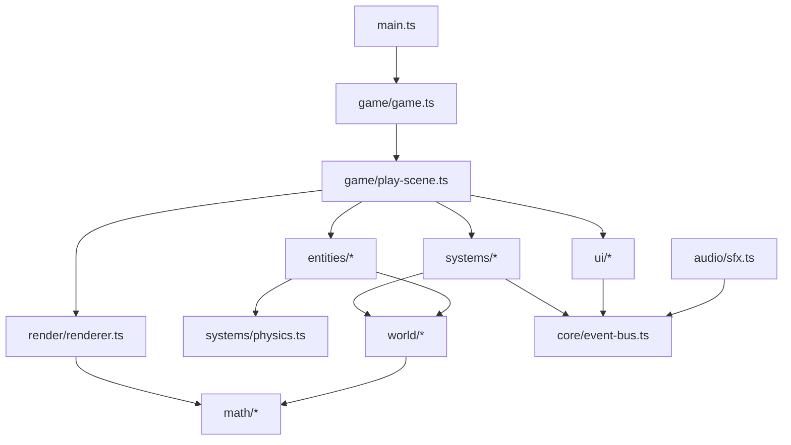

# GTA-Style Open World: Build Plan

## 1. Summary

Build a single-player, third-person open-world action game in the browser. The player walks and drives through a procedurally generated city, fights, evades police, and completes simple missions. The game uses no existing game engine. We write our own game loop, renderer, physics, AI, and UI on top of the browser platform.

Out of scope: saving, multiplayer, and scalability (server, persistence, and networking).

Working title: **Vice Harbor** (placeholder). The game uses original names, models, and content. It does not reuse Rockstar's trademarks, city names, characters, or assets.

## 2. Assumptions (confirm before building)

| Decision | Default chosen | Alternative |
|---|---|---|
| Platform | Desktop browser (Chrome, Edge, Safari, Firefox) | Electron or native app |
| Language | TypeScript (strict mode) | Plain JavaScript |
| Renderer | Raw WebGL2 | Canvas 2D (simpler, far slower, no real 3D) |
| Libraries | Lodash, Zod (per workspace rules) | None |
| Build tooling | Vite (bundler and dev server only) | Custom esbuild script |
| Art | Procedural primitives and vertex colors | Imported glTF models (later) |
| Input | Keyboard and mouse | Gamepad (stretch goal) |
| City size | About 1 km x 1 km, roughly 20 x 20 blocks | Larger map (needs chunk streaming) |

Note: Vite and the libraries above are tooling, not game engines. Physics, rendering, AI, and game logic stay hand-written.

## 3. Tech Stack

- **Runtime:** Browser, `requestAnimationFrame` loop, Web Audio API.
- **Rendering:** WebGL2 with custom shaders (GLSL in TS template strings).
- **Math:** Our own `Vec3`, `Mat4`, `Quat`-free yaw/pitch camera, AABB, OBB, and ray utilities. Use preallocated scratch objects in hot loops to avoid garbage collection spikes.
- **Config validation:** Zod schemas for vehicles, weapons, missions, and city parameters. Export inferred types with `z.infer`.
- **Testing:** Vitest for pure logic (math, collision, RNG, road graph, state machines).
- **Dev tooling:** Vite, TypeScript, ESLint, Prettier.

## 4. Architecture

### 4.1 Module layout

Files use kebab-case. Classes use PascalCase. Constants use UPPER_SNAKE_CASE.

```text
src/
  main.ts                    # Bootstraps canvas, starts the game
  core/
    game-loop.ts             # Fixed-step update (60 Hz) and variable render
    input.ts                 # Keyboard and mouse state, edge detection
    rng.ts                   # Seeded PRNG (mulberry32) for repeatable worlds
    event-bus.ts             # Typed pub/sub for cross-system events
    scene.ts                 # Scene interface (menu, play, pause)
  math/
    vec3.ts  mat4.ts  aabb.ts  obb.ts  ray.ts  util.ts
  render/
    gl-context.ts            # WebGL2 setup, resize, state helpers
    shader-program.ts        # Compile and link, uniform cache
    shaders/                 # Lit vertex-color shader, sky, HUD quad
    mesh.ts                  # VAO/VBO wrapper, static and dynamic meshes
    mesh-builder.ts          # Box, ramp, cylinder, and quad generators
    camera.ts                # Third-person and free camera
    renderer.ts              # Draw queue, frustum culling, fog, sky
  world/
    city-generator.ts        # Seeded layout: roads, blocks, lots, buildings
    road-graph.ts            # Nodes and lanes for traffic and pursuit
    chunk.ts                 # Groups static geometry per 100 m tile
    collision-world.ts       # Static AABB store and uniform grid index
    spatial-grid.ts          # Hash grid for broadphase queries
  entities/
    entity.ts                # Base: position, velocity, health, alive flag
    player.ts                # On-foot controller and inventory
    vehicle.ts               # Arcade car model, wheel raycasts
    pedestrian.ts            # Waypoint walker, flee and fight states
    traffic-car.ts           # Lane follower with spacing
    police-car.ts            # Pursuit steering
    projectile.ts            # Hitscan bullets (and optional thrown items)
  systems/
    physics.ts               # Gravity, ground probe, collision resolution
    combat.ts                # Melee, shooting, damage, death events
    wanted.ts                # Heat level 0-5, crimes, cooldown
    police-ai.ts             # Spawn, search, and pursue logic
    missions.ts              # Mission state machine and objectives
    pickups.ts               # Cash, health, and weapon pickups
    spawner.ts               # Keeps NPC counts near target, off-screen only
  ui/
    hud.ts                   # Health, wanted stars, cash, speed, prompts
    minimap.ts               # Top-down 2D overlay of roads and markers
    menus.ts                 # Title, pause, and mission complete screens
    text.ts                  # Bitmap or Canvas-generated text atlas
  audio/
    sfx.ts                   # Synthesized engine, gunshot, and siren tones
  data/
    schemas.ts               # Zod schemas for all configs
    vehicles.config.ts
    weapons.config.ts
    missions.config.ts
    city.config.ts
  game/
    game.ts                  # Owns systems, scene switching, world state
    play-scene.ts            # Main gameplay scene
tests/
  unit/                      # Vitest specs mirror src/ layout
```

### 4.2 Dependency direction

Lower layers do not import higher layers. Systems communicate through the event bus, not direct calls.



### 4.3 Main loop

- Fixed update at 60 Hz for physics, AI, and combat. Accumulate frame time and clamp it to 0.25 s to avoid spiral-of-death.
- Render once per animation frame. Interpolate render transforms between the last two physics states to smooth motion on 120 Hz displays.
- Input is sampled once per fixed step. Edge-triggered actions (jump, enter vehicle, fire) latch until consumed.

### 4.4 Key data flow

1. `city-generator` produces road graph, building boxes, and spawn points from a seed.
2. `chunk` builds static meshes per 100 m tile. Collision boxes go into `collision-world`.
3. Each fixed step: input, then AI, then physics, then combat and wanted, then missions, then events.
4. Each frame: frustum-cull chunks and entities, then draw sky, world, entities, and then HUD.

## 5. Core Systems Design

### 5.1 World generation

- Seeded grid: roads every 60 m, with 2 lanes each direction. Blocks of 40 x 40 m contain 2 to 4 buildings.
- Building heights are random per seed, between 8 m and 60 m. Each building is a box with a random color from a palette.
- Road graph: one node per intersection, one directed edge per lane. Traffic and police follow edges.
- Sidewalks are slightly raised quads. Pedestrians walk on sidewalks.

### 5.2 Physics and collision

- Static world: axis-aligned boxes (buildings, curbs, props). Broadphase uses a uniform hash grid of 10 m cells.
- Player: capsule approximated as a vertical AABB. Move in X, then Z, then Y to resolve sliding. Step up ledges up to 0.4 m.
- Vehicles: oriented box in XZ plane, separating axis test against AABBs. Wheel raycasts provide ground height and suspension.
- Vehicle model: arcade bicycle model with throttle, brake, steer, and simple grip. Speed-based steering reduction, handbrake drift, and collision damage above a threshold.
- No rigid-body solver. We accept simple response (push out along minimum penetration axis).

### 5.3 Rendering

- One lit shader with per-vertex color, directional sun light, ambient term, and linear distance fog.
- Sky: fullscreen gradient pass drawn before the world. Sun direction changes slowly with time of day (stretch).
- Frustum culling per chunk and per entity using bounding spheres.
- Draw budget target: under 300 draw calls per frame. Chunk geometry is merged per tile so most buildings are one draw.
- Shadows: stretch goal (single cascade shadow map). Not in MVP.

### 5.4 Player

- States: `onFoot`, `inVehicle`, `dead`.
- On foot: walk, sprint, jump, melee, aim and shoot. Stamina is optional.
- Third-person camera orbits the player with mouse. Camera collision pulls in when blocked by buildings.
- Health: 100 max. Regenerates slowly when out of combat (stretch).

### 5.5 Vehicles

- Enter by pressing `F` near a vehicle door. Exit with `F`.
- Driver and passenger seats: passenger does not control. Keep single-seat for MVP.
- Chase camera follows with speed-based distance and slight lag.
- Traffic cars use the same vehicle model with an AI driver that steers toward the next road node.

### 5.6 NPCs and traffic

- **Pedestrians:** walk along sidewalk waypoints. Idle, walk, and flee states. Flee when shot, hit, or when a car approaches fast.
- **Traffic:** follow lane edges. Keep a minimum gap to the car ahead. Stop at a simple red and green cycle (no traffic light AI beyond this).
- **Spawner:** keeps about 40 pedestrians and 20 traffic cars near the player. Spawns only outside the camera frustum and beyond 40 m, and despawns beyond 120 m.

### 5.7 Combat

- Melee: short-range cone check on press. Damage 10 per hit.
- Pistol: hitscan ray from camera center, damage 25 with falloff by distance. Max range 150 m. Fire rate 4 per second. Limited magazine with reload.
- Vehicles can run over pedestrians. Impact above a speed threshold kills.
- Damage events go to the event bus. Wanted system listens for crimes.
- Death: fade to black, lose cash fraction, respawn at a hospital marker. No saving required.

### 5.8 Wanted system

- Heat levels 0 to 5, shown as stars.
- Crimes that raise heat: shooting near police, killing pedestrians, hitting a pedestrian with a car, car crash above threshold, destroying a police car.
- Police spawn at heat 1 and above. Units scale with heat level.
- Escape: break line of sight for 20 s, then heat decays one level per 15 s.
- Police AI: states `patrol`, `search` (last known position), and `pursue` (steer toward player, with simple obstacle avoidance using raycasts).

### 5.9 Missions

- Mission defined in data (Zod schema): id, title, steps, rewards.
- Step types: `goToMarker`, `driveVehicleTo`, `eliminateTarget`, `collectPickups`.
- Finite state machine per mission. One active mission at a time. HUD shows objective text and marker on minimap.
- Ship 3 missions for the vertical slice.

### 5.10 HUD and UI

- Overlays: health bar, wanted stars, cash, speed and gear for vehicles, weapon and ammo, mission text, interaction prompts.
- Minimap: top-down canvas, rotates with player heading. Shows roads, player, markers, police blips.
- Menus: title screen (start), pause (resume, controls, quit to title), mission complete.
- HUD draws to a separate 2D canvas overlay. Redraw only on state change or at 10 Hz for minimap.

### 5.11 Audio

- Web Audio with synthesized sounds: oscillator engine tone scaled by speed, noise burst for gunshot, two-tone siren for police.
- No audio files required for MVP.
- Respect browser autoplay rules: create `AudioContext` after the first user gesture.

## 6. Data and Configuration (Zod)

All tunable values live in config files and are validated at startup. Invalid config stops the game with a clear error.

Example schema shape:

```ts
import { z } from 'zod';

export const VehicleConfigSchema = z.object({
  id: z.string(),
  maxSpeed: z.number().positive(),
  acceleration: z.number().positive(),
  brakeForce: z.number().positive(),
  steerRateDegPerSec: z.number().positive(),
  mass: z.number().positive(),
  size: z.object({ length: z.number(), width: z.number(), height: z.number() }),
});

export type VehicleConfig = z.infer<typeof VehicleConfigSchema>;
```

## 7. Milestones

Each milestone ends in a playable or visible checkpoint. Do not start the next milestone until the checkpoint passes.

### M0: Project scaffold
- Vite + TypeScript strict, Vitest, ESLint, Prettier.
- Canvas fills window, game loop runs at fixed step.
- Checkpoint: `npm run dev` shows a cleared canvas with FPS counter. `npm test` runs.

### M1: Renderer and camera
- WebGL2 context, shader program, mesh builder (box, ramp, quad).
- Free camera with WASD and mouse look.
- Checkpoint: colored lit boxes with fog and sky gradient, camera moves smoothly.

### M2: City generation
- Seeded city, roads, sidewalks, buildings, road graph.
- Chunk meshes and frustum culling.
- Checkpoint: fly-through of a full city at 60 FPS on a mid-range laptop. Same seed gives same city.

### M3: On-foot movement
- Player controller, gravity, ground probe, jump, step-up.
- Collision with buildings. Third-person camera with wall avoidance.
- Checkpoint: walk the city, cannot pass through buildings, jump onto curbs.

### M4: Vehicles
- Enter and exit, arcade car model, collision with world and buildings.
- Chase camera, speedometer, engine sound (stretch in M9).
- Checkpoint: drive around the city, corner at speed, bump into things and stop properly.

### M5: NPCs and traffic
- Pedestrian walkers on sidewalks. Traffic cars on lanes with spacing.
- Spawner keeps counts near the player, off-screen only.
- Checkpoint: populated city, traffic stops for other cars, pedestrians walk on sidewalks.

### M6: Combat and death
- Melee, pistol with hitscan and tracers, damage, pedestrian flee.
- Death and respawn with cash penalty.
- Checkpoint: punch and shoot pedestrians, they react. Death respawns the player at the hospital.

### M7: Wanted and police
- Heat system, crimes, police spawns, police AI (patrol, search, pursue).
- Checkpoint: shoot a pedestrian near a police car, get stars, police chase, escape by breaking line of sight.

### M8: Missions and HUD
- Mission state machine, three missions, markers, minimap, full HUD, pause and title menus.
- Checkpoint: complete all three missions from the title screen with no debug tools.

### M9: Polish and performance
- Engine sound, siren, gunshot sounds, day and night sun cycle (stretch).
- Profiling pass: reduce draw calls, cache bounding boxes, remove per-frame allocations.
- Tuning pass on vehicle handling and police difficulty.
- Checkpoint: 60 FPS in the populated city, 30-minute play session with no crashes.

## 8. Testing Strategy

- **Unit (Vitest):** math utilities, AABB and OBB intersections, RNG determinism, city generator invariants (roads connect, no building overlaps road), road graph pathing, wanted state transitions, mission state machine, Zod schema validation.
- **Integration:** headless simulation of fixed steps for 10 s of game time to catch NaN values and runaway velocities.
- **Manual playtest checklist:** each milestone checkpoint above, plus controls, pause, death, and mission restart.
- **Performance:** browser devtools frame timing and a counter for draw calls and entity count shown in a debug overlay (toggle with a key).

## 9. Controls (initial)

| Action | Key |
|---|---|
| Move | W A S D |
| Sprint | Shift |
| Jump | Space |
| Look | Mouse |
| Enter or exit vehicle | F |
| Melee | Left click (on foot) |
| Shoot | Left click (armed) |
| Reload | R |
| Handbrake | Space (in vehicle) |
| Pause | Esc |
| Debug overlay | F3 |

## 10. Operations and Delivery

- Scripts: `npm run dev`, `npm run build`, `npm test`, `npm run lint`.
- Build output is static files. Host on any static host (for example, Vercel) with no server.
- No network calls at runtime, no accounts, no stored user data. This keeps the security surface minimal.
- Keep a changelog in the repo and tag each milestone with a git tag.
- Commit after each milestone using conventional commit messages (per workspace rules).

## 11. Risks and Mitigations

| Risk | Impact | Mitigation |
|---|---|---|
| Custom physics feels wrong | High | Keep arcade model, tune with config values, playtest each milestone |
| Too many draw calls with a populated city | High | Merge static geometry per chunk, instance NPC meshes, cull early |
| Police AI gets stuck on buildings | Medium | Raycast steering, fallback teleport to the nearest road node after timeout |
| Scope creep toward full GTA content | High | Lock the MVP to 3 missions and one city district; treat extras as stretch |
| Floating point drift in long sessions | Low | Re-normalize rotations, clamp velocities, reset on out-of-bounds |

## 12. Open Questions for You

1. Platform: is a desktop browser acceptable, or do you need a native build?
2. Renderer: confirm raw WebGL2 (recommended) over Canvas 2D.
3. Scope of MVP: is one city district with three missions the right first target?
4. Art direction: is a stylized, low-poly look with primitives acceptable for now?

## 13. Next Step

Once the assumptions above are confirmed, start with M0 (project scaffold). Each milestone is a separate, reviewable change.
